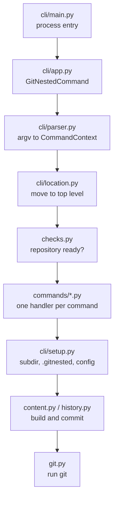

# Architecture

This page is for people who want to change git-nested. It shows how the code
is built and why.

## Goals

- **Plain git underneath.** git-nested only runs git. Everything it makes is
  a normal commit, branch or ref.
- **One source of truth.** The command line is defined once, as data. The
  parser, `--help`, shell completion and the tests read the same tables.
- **Safe by default.** A command checks first, then changes. If it fails
  halfway, it undoes its staged changes or leaves a worktree you can clean.

## How a command runs

1. `cli/main.py` starts the program. It maps errors to exit codes.
2. `cli/app.py` sets up output and runs the command. With `--all` it runs
   the handler once per nested repository.
3. `cli/parser.py` builds `argparse` from `cli/spec.py` and returns a
   `CommandContext`.
4. `cli/location.py` moves to the top of the repository. It rewrites the
   paths you gave, so they still mean the same.
5. `checks.py` checks the repository: inside a work tree, not on a nested
   branch, clean where needed.
6. The handler in `commands/<name>.py` does the work. Most start with
   `cli/setup.py`, which finds the folder, its `.gitnested` and its
   config.

## Modules

### Command line: `cli/`

| Module | Role |
|---|---|
| `spec.py` | the tables that define the command line: commands, options, help texts, examples |
| `parser.py` | turns argv into a command name and a `CommandContext` |
| `app.py` | the application object; dispatches to the handlers |
| `location.py` | runs from any folder of the repository, the way git does |
| `setup.py` | resolves `<subdir>` into the four things every command needs |
| `main.py` | the process entry point |

### Commands: `commands/`

One module per command, for example `commands/pull.py`. Each has one
`cmd_<name>(ctx)` handler. `commands/__init__.py` holds the registry.

### Core

| Module | Role |
|---|---|
| `history.py` | rebuilds the nested history: the core algorithm |
| `content.py` | creates the nested branch, places its content, commits |
| `filters.py` | applies `filter` and `exclude` |
| `gitfile.py` | reads and writes `.gitnested`, and the level files |
| `refs.py` | names of the nested branches and refs |
| `worktree.py` | temporary worktrees and their branches |
| `submodules.py` | submodules in the content of a nested repository |
| `discovery.py` | finds nested repositories; asks upstream about branches |
| `checks.py` | checks before a command runs |

### Support

| Module | Role |
|---|---|
| `git.py` | runs git as a subprocess |
| `output.py` | everything git-nested prints; hides credentials |
| `messages.py` | the long help texts, for example after a conflict |
| `models.py` | `Flags`, `NestedConfig`, `CommandContext` |
| `yamlio.py` | reads and writes the YAML of `.gitnested` |
| `errors.py` | `GitNestedError`, the one exception type |
| `constants.py` | shared names |
| `_version.py` | the version |
| `_compat.py` | pieces older Pythons do not have |
| `completion/` | shell completion, from the same tables as the parser |

## Key decisions

### The command line is data

`cli/spec.py` holds every command, option, help text and example as plain
data. The parser, the completion scripts and `config` read these tables. So
they can not disagree. Tests check that the manual page and these docs
cover every command and option.

### Rebuild the history every time

git-nested stores no nested history of its own. Each time it needs one, it
rebuilds it from the sync point. See
[How it works](../concepts/how-it-works.md#rebuilding-the-nested-history).

- Pro: nothing can get out of step. A clone of your repository has all it
  needs.
- Con: it costs time on long histories. So the rebuild only walks the
  commits since the sync point, and builds trees in a private index.

### Work in a separate worktree

Merges and rebases run in a worktree under `.git/tmp/nested/`. Your working
tree is never touched until the result is ready. A conflict waits there.

### Leave the user's hooks alone

Internal commits use `--no-verify`, and worktrees are made without checkout.
Your hooks are for your changes. `nested.verify` turns them on.

### Talk like git

Paths are relative to where you are. Messages name the folder first:
`ext/lib: pulled from …`. Results go to stdout, messages to stderr.

## Git calls

[Git call diagrams](diagrams.md) show the git commands of each command, in
order. Update them when a command's git calls change.
