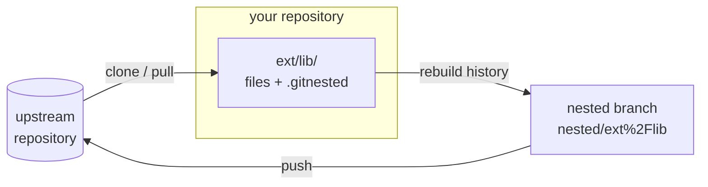

# How it works

This page explains what git-nested does inside. You do not need it for
daily use. It helps when something goes wrong.

[Git call diagrams](../architecture/diagrams.md) show the exact git commands
of each command.

## The picture

The nested files live in your repository as normal files. To talk to
upstream, git-nested rebuilds their history as a branch of its own. That
branch looks like upstream: its files are at the top, not under `ext/lib/`.

## The `.gitnested` file

Each nested folder has a `.gitnested` file. Its most important fields:

| Field | Meaning |
|---|---|
| `remote` | where upstream is |
| `branch` | the upstream branch you follow |
| `commit` | the upstream commit your files are based on |
| `parent` | your commit at which the files and upstream were last equal |

`commit` and `parent` together are the **sync point**. They say: "at my
commit `parent`, the folder held upstream commit `commit`".

All fields are described in
[The `.gitnested` file](../configuration/gitnested-file.md).

## Clone

1. Fetch the upstream branch.
2. Put its files into the folder.
3. Write `.gitnested` with `remote`, `branch`, `commit` and `parent`.
4. Make one commit, "git nested clone".

## Rebuilding the nested history

`branch`, `pull` and `push` all start the same way. They build the nested
branch:

1. Take every commit of yours since `parent`.
2. For each one, take only the files of the nested folder. Leave out
   `.gitnested`.
3. Make a new commit from them, on top of the upstream commit in
   `commit`.

The result is a branch whose history starts at upstream and then has your
local commits. Your commit messages and authors are kept. A commit that does
not touch the folder is skipped.

This is why git-nested needs `parent`. If `parent` is lost, for example after
a squash merge, see [Squash merges and rebases](../guides/squash-merges.md).

## Pull

1. Fetch the upstream branch into `refs/nested/<subdir>/fetch`.
2. Stop if there is nothing new.
3. Build the nested branch, as above.
4. Join upstream into it:
   - `merge` (default): `git merge` of upstream into the nested branch.
   - `rebase`: `git rebase` of your local commits onto upstream.
5. Put the result into the folder and update `.gitnested`.
6. Make one commit, "git nested pull". Its message lists up to 20 upstream
   commits.

If step 4 has conflicts, git-nested stops. The nested branch stays checked
out in a worktree, and git-nested prints the steps to finish. See
[Resolve conflicts](../guides/conflicts.md).

With `--no-squash`, step 6 makes a merge commit instead. Its second parent is
the upstream history, moved into the folder. So `git log` shows each
upstream commit.

## Push

1. Pick the target branch upstream (see below).
2. Fetch it. If it has commits you do not have, stop: pull first.
3. Build the nested branch, as above. With `rebase`, rebase it onto
   upstream.
4. Push the nested branch to the target branch.
5. With `--commit`, record the pushed commit in `.gitnested` and make a
   commit, "git nested push".
6. Remove the nested branch again.

### Which branch does push use?

| You give | Push goes to |
|---|---|
| `-b <name>` | `<name>` |
| nothing, and upstream has the tracked branch | `<your repo>-<branch>`, for example `app-main` |
| nothing, and upstream does not have the tracked branch yet | the tracked branch |

So by default a push makes a review branch. You open a pull request
upstream, it is merged, and then you pull.

`--commit` only works for a push to the tracked branch. Otherwise the next
pull would start from a commit the tracked branch does not have.

## What does `merge` or `rebase` mean here?

The join method only changes the history of the nested branch. The commit in
your repository is the same kind either way.

- **merge** keeps the history as it happened. Each pull adds a merge commit
  to the nested history. A later push sends those merge commits upstream
  too.
- **rebase** moves your local commits on top of upstream. The pushed history
  is a straight line. Use it when upstream wants linear history.

Set it once in `.gitnested` with `git nested config <subdir> method rebase`,
or per command with `--rebase`.

## Temporary things

While it works, git-nested makes:

- the nested branch `nested/<subdir>`,
- a worktree for it under `.git/tmp/nested/<subdir>`,
- refs under `refs/nested/<subdir>/`, for example `refs/nested/ext/lib/fetch`,
- after `branch`, a git remote with the name of the nested branch. It points
  at upstream.

A pull that succeeds removes the worktree and keeps the branch. The next
pull builds it again. A push removes the branch it built. `git nested clean`
removes branch, worktree and remote by hand.

A `/` in `<subdir>` becomes `%2F` in the branch name. So `lib/inner` gets
`nested/lib%2Finner`, which does not clash with `nested/lib`.

In a linked worktree of your repository, the name gets `@<worktree>` at the
end, for example `nested/lib@wt`. So two worktrees do not block each
other.

## Clean working tree

Commands that change your repository need a clean working tree: `clone`,
`init`, `pull`, `commit`, `repair` and `push --commit`. Commit or stash your
changes first.

`branch`, `diff` and `push` without `--commit` only read committed history.
Changes elsewhere do not block them. If the nested folder has uncommitted
changes, they warn and ignore them.

## Your hooks

git-nested does not run the hooks of your repository on its own commits.
Those hooks are for your changes, not for upstream content. See
[Hooks and signing](../guides/hooks-and-signing.md) to turn them on.
