# git-nested — Subcommand Git Call Diagrams

Each diagram below shows the sequence of underlying `git` commands executed by a `git nested` subcommand.

---

## clone

```mermaid
sequenceDiagram
    participant User
    participant git-nested
    participant Git

    User->>git-nested: git nested clone <subdir> <remote>
    git-nested->>Git: rev-parse --show-prefix
    Note over git-nested: Below the top level: rev-parse --show-toplevel,<br/>paths rebased, then run from there
    git-nested->>Git: rev-parse --git-dir
    git-nested->>Git: rev-parse --git-dir
    git-nested->>Git: symbolic-ref --short --quiet HEAD
    git-nested->>Git: rev-parse --is-inside-work-tree
    git-nested->>Git: update-index -q --ignore-submodules --refresh
    git-nested->>Git: diff-files --quiet --ignore-submodules
    git-nested->>Git: rev-list HEAD -1
    Note over git-nested: Validate HEAD exists<br/>(skip the three checks below if it does not)
    git-nested->>Git: rev-parse --verify HEAD
    git-nested->>Git: diff-index --quiet --ignore-submodules HEAD
    git-nested->>Git: diff-index --quiet --cached --ignore-submodules HEAD
    git-nested->>Git: rev-parse HEAD
    Note over git-nested: In a repo with no commits yet,<br/>the clone commit becomes the root commit<br/>and .gitnested leaves parent empty

    opt No branch specified
        git-nested->>Git: ls-remote --symref <remote>
        Note over git-nested: Determine upstream default branch
    end

    rect rgb(230, 245, 255)
        Note over git-nested,Git: do_fetch
        git-nested->>Git: fetch --no-tags --quiet <remote> <branch>
        Note over git-nested: In a terminal: --progress, not --quiet, and a line naming the remote
        git-nested->>Git: rev-parse FETCH_HEAD^0
        opt pin configured
            git-nested->>Git: fetch --no-tags --quiet <remote> <pin>
            git-nested->>Git: merge-base --is-ancestor <pinned> <branch tip>
        end
        git-nested->>Git: update-ref refs/nested/<subref>/fetch <branch tip or pinned>
    end

    alt --adopt
        git-nested->>Git: ls-files -- <subdir>
        git-nested->>Git: log --format=%H %T <upstream_head>
        Note over git-nested: Find the newest upstream commit<br/>whose tree matches <subdir> at HEAD
        Note over git-nested: Write .gitnested YAML
        git-nested->>Git: rev-parse <matching_commit>
        git-nested->>Git: add -f -- <subdir>/.gitnested
        git-nested->>Git: commit --no-verify [--signoff] [-S] -m <message>
        Note over git-nested: If it fails: reset -q --hard HEAD
        git-nested->>Git: update-ref refs/nested/<subref>/commit <matching_commit>
    else Plain clone
        Note over git-nested: mkdir <subdir>/

        rect rgb(230, 255, 230)
            Note over git-nested,Git: commit_nested_branch
            git-nested->>Git: rev-list <upstream_commit> -1
            git-nested->>Git: merge-base --is-ancestor <upstream> <nested_ref>
            git-nested->>Git: ls-files -- <subdir>
            git-nested->>Git: read-tree --prefix=<subdir> -u <nested_commit_ref>
            Note over git-nested: Write .gitnested YAML
            git-nested->>Git: rev-parse <nested_commit_ref>
            git-nested->>Git: add -f -- <subdir>/.gitnested
            git-nested->>Git: diff --cached --quiet
            git-nested->>Git: commit --no-verify [--signoff] [-S] -m <message>
            Note over git-nested: If it fails: reset -q --hard HEAD
            git-nested->>Git: update-ref refs/nested/<subref>/commit <nested_commit_ref>
        end
    end

    opt Upstream has submodules
        git-nested->>Git: ls-files -s -z -- <subdir>
        alt --recurse-submodules
            loop For each submodule
                git-nested->>Git: config -f <subdir>/.gitmodules --get-regexp ...
                git-nested->>Git: rm -q --cached -- <path>
                Note over git-nested: Clone its url at the pinned commit (-b <commit>)
            end
        else
            Note over git-nested: Warn that they stay empty
        end
    end
```

---

## init

```mermaid
sequenceDiagram
    participant User
    participant git-nested
    participant Git

    User->>git-nested: git nested init <subdir>
    git-nested->>Git: rev-parse --show-prefix
    Note over git-nested: Below the top level: rev-parse --show-toplevel,<br/>paths rebased, then run from there
    git-nested->>Git: rev-parse --git-dir
    git-nested->>Git: rev-parse --git-dir
    git-nested->>Git: symbolic-ref --short --quiet HEAD
    git-nested->>Git: rev-parse --is-inside-work-tree
    git-nested->>Git: update-index -q --ignore-submodules --refresh
    git-nested->>Git: diff-files --quiet --ignore-submodules
    git-nested->>Git: rev-parse --verify HEAD
    git-nested->>Git: diff-index --quiet --ignore-submodules HEAD
    git-nested->>Git: diff-index --quiet --cached --ignore-submodules HEAD
    git-nested->>Git: rev-parse HEAD
    git-nested->>Git: ls-files -- <subdir>
    Note over git-nested: Validate subdir is tracked

    alt --commit without --branch
        git-nested->>Git: ls-remote --symref <remote>
        Note over git-nested: Determine upstream default branch
        git-nested->>Git: fetch --no-tags --quiet <remote> <branch>
        git-nested->>Git: rev-parse FETCH_HEAD^0
        git-nested->>Git: update-ref refs/nested/<subref>/fetch FETCH_HEAD^0
        git-nested->>Git: rev-list <commit> -1
        git-nested->>Git: merge-base --is-ancestor <commit> <fetched_head>
    else No branch specified
        git-nested->>Git: config --get init.defaultbranch
    end

    rect rgb(230, 245, 255)
        Note over git-nested,Git: update_gitrepo_file
        Note over git-nested: Write .gitnested YAML
        git-nested->>Git: rev-parse <nested_commit_ref>
        git-nested->>Git: add -f -- <subdir>/.gitnested
    end

    git-nested->>Git: commit --no-verify [--signoff] [-S] -m <message>
    Note over git-nested: If it fails: reset -q --hard HEAD
    git-nested->>Git: update-ref refs/nested/<subref>/commit <nested_commit_ref>

    opt --from-submodule
        git-nested->>Git: config -f .gitmodules --get-regexp ...
        git-nested->>Git: ls-tree HEAD -- <subdir>
        git-nested->>Git: submodule deinit -q -f -- <subdir>
        git-nested->>Git: rm -q -f -- <subdir>
        Note over git-nested: Remove .git/modules/<name>; clone its url at the pinned commit
    end
```

---

## fetch

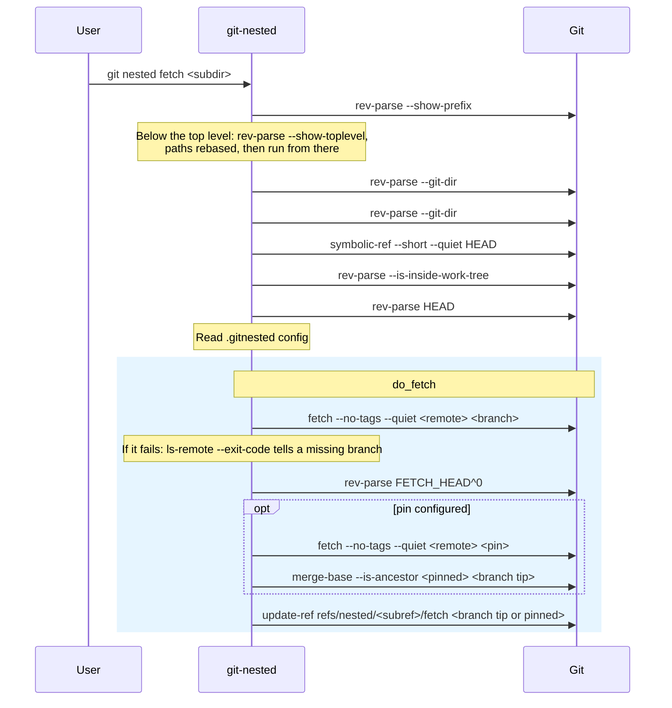

---

## pull

```mermaid
sequenceDiagram
    participant User
    participant git-nested
    participant Git

    User->>git-nested: git nested pull <subdir>
    git-nested->>Git: rev-parse --show-prefix
    Note over git-nested: Below the top level: rev-parse --show-toplevel,<br/>paths rebased, then run from there
    git-nested->>Git: rev-parse --git-dir
    git-nested->>Git: rev-parse --git-dir
    git-nested->>Git: symbolic-ref --short --quiet HEAD
    git-nested->>Git: rev-parse --is-inside-work-tree
    git-nested->>Git: update-index -q --ignore-submodules --refresh
    git-nested->>Git: diff-files --quiet --ignore-submodules
    git-nested->>Git: rev-parse --verify HEAD
    git-nested->>Git: diff-index --quiet --ignore-submodules HEAD
    git-nested->>Git: diff-index --quiet --cached --ignore-submodules HEAD
    git-nested->>Git: rev-parse HEAD

    rect rgb(230, 245, 255)
        Note over git-nested,Git: do_fetch
        git-nested->>Git: fetch --no-tags --quiet <remote> <branch>
        git-nested->>Git: rev-parse FETCH_HEAD^0
        opt pin configured
            git-nested->>Git: fetch --no-tags --quiet <remote> <pin>
            git-nested->>Git: merge-base --is-ancestor <pinned> <branch tip>
        end
        git-nested->>Git: update-ref refs/nested/<subref>/fetch <branch tip or pinned>
    end

    alt Up to date
        Note over git-nested: Return early (no changes)
    else Has changes
        rect rgb(255, 245, 230)
            Note over git-nested,Git: delete_branch (cleanup old)
            git-nested->>Git: worktree prune
            git-nested->>Git: rev-parse --git-dir
            Note over git-nested: Remove empty parent dirs up to .git/tmp
            git-nested->>Git: branch -D nested/<subref>
        end

        rect rgb(230, 245, 255)
            Note over git-nested,Git: create_nested_branch
            git-nested->>Git: rev-list refs/heads/nested/<subref> -1
            Note over git-nested: Check branch existence
            git-nested->>Git: rev-list refs/heads/nested -1
            Note over git-nested: Abort if a branch named nested is in the way

            alt Has parent commit (incremental)
                git-nested->>Git: merge-base --is-ancestor <parent> HEAD
                git-nested->>Git: rev-list --reverse --topo-order --ancestry-path --parents <parent>..HEAD
                loop For each commit, merges included
                    git-nested->>Git: cat-file -p <commit>:<subdir>/.gitnested
                    Note over git-nested: Its tree, in a temporary index
                    git-nested->>Git: read-tree <commit>:<subdir>
                    git-nested->>Git: rm --cached -r -q -f --ignore-unmatch -- .gitnested <dropped>
                    git-nested->>Git: write-tree
                    opt Two or more parents
                        git-nested->>Git: merge-base --independent <parents>
                    end
                    opt The tree changes
                        git-nested->>Git: log -1 --format=%ad%n%ae%n%an%n%cd%n%ce%n%cn%n%B <commit>
                        git-nested->>Git: commit-tree [-S] -p <parents> <tree>
                    end
                end
                git-nested->>Git: branch nested/<subref> <tip>
            else No parent (first time)
                git-nested->>Git: rev-list --reverse --topo-order --parents HEAD -- <subdir>
                Note over git-nested: Replay each commit as above, with no upstream to join
                git-nested->>Git: branch nested/<subref> <tip>
            end

            git-nested->>Git: worktree add --no-checkout <worktree_path> nested/<subref>
            git-nested->>Git: reset -q --hard (in the worktree)
            git-nested->>Git: update-ref refs/nested/<subref>/branch nested/<subref>
        end

        alt method = merge
            git-nested->>Git: merge --ff --no-edit refs/nested/<subref>/fetch
            Note over git-nested: (in worktree)
        else method = rebase
            git-nested->>Git: rebase --onto refs/nested/<subref>/fetch <recorded commit> nested/<subref>
            Note over git-nested: (in worktree)
        end

        git-nested->>Git: update-ref refs/nested/<subref>/branch nested/<subref>

        alt default squash
            rect rgb(230, 255, 230)
                Note over git-nested,Git: commit_nested_branch
                git-nested->>Git: rev-parse refs/nested/<subref>/fetch
                git-nested->>Git: ls-files -- <subdir>
                git-nested->>Git: rm -r -- <subdir>
                git-nested->>Git: read-tree --prefix=<subdir> -u <nested_commit_ref>
                Note over git-nested: Write .gitnested YAML
                git-nested->>Git: add -f -- <subdir>/.gitnested
                git-nested->>Git: diff --cached --quiet
                git-nested->>Git: commit --no-verify [--signoff] [-S] -m <message>
                Note over git-nested: If it fails: reset -q --hard HEAD
                git-nested->>Git: worktree prune
                git-nested->>Git: rev-parse --git-dir
                Note over git-nested: Remove empty parent dirs up to .git/tmp
                git-nested->>Git: update-ref refs/nested/<subref>/commit <nested_commit_ref>
            end
        else --no-squash or squash: false
            loop For each commit on the nested branch
                git-nested->>Git: read-tree --empty
                git-nested->>Git: read-tree --prefix=<subdir> <commit>^{tree}
                git-nested->>Git: write-tree
                git-nested->>Git: log -1 --format=%ad%n%ae%n%an%n%cd%n%ce%n%cn%n%B <commit>
                git-nested->>Git: commit-tree [-S] -p <rewritten parents> <tree>
            end
            git-nested->>Git: merge --no-commit --no-ff -s ours --allow-unrelated-histories <rewritten tip>
            git-nested->>Git: ls-files -- <subdir>
            git-nested->>Git: rm -r -- <subdir>
            git-nested->>Git: read-tree --prefix=<subdir> -u <nested_commit_ref>
            Note over git-nested: Write .gitnested YAML
            git-nested->>Git: add -f -- <subdir>/.gitnested
            git-nested->>Git: commit --no-verify [--signoff] [-S] -m <message>
            git-nested->>Git: worktree prune
            git-nested->>Git: rev-parse --git-dir
            Note over git-nested: Remove empty parent dirs up to .git/tmp
            git-nested->>Git: update-ref refs/nested/<subref>/commit <nested_commit_ref>
        end
    end

    opt Submodules of upstream that were nested, or --recurse-submodules
        Note over git-nested: Nest each at the commit upstream pins now (as in clone)
    end
```

---

## push

```mermaid
sequenceDiagram
    participant User
    participant git-nested
    participant Git

    User->>git-nested: git nested push <subdir>
    git-nested->>Git: rev-parse --show-prefix
    Note over git-nested: Below the top level: rev-parse --show-toplevel,<br/>paths rebased, then run from there
    git-nested->>Git: rev-parse --git-dir
    git-nested->>Git: rev-parse --git-dir
    git-nested->>Git: symbolic-ref --short --quiet HEAD
    git-nested->>Git: rev-parse --is-inside-work-tree
    git-nested->>Git: update-index -q --ignore-submodules --refresh
    git-nested->>Git: diff-files --quiet --ignore-submodules
    git-nested->>Git: rev-parse --verify HEAD
    git-nested->>Git: diff-index --quiet --ignore-submodules HEAD
    git-nested->>Git: diff-index --quiet --cached --ignore-submodules HEAD
    git-nested->>Git: rev-parse HEAD

    opt No -b
        git-nested->>Git: ls-remote --exit-code <remote> refs/heads/<branch>
        Note over git-nested: Upstream lacks the tracked branch: push to it
        git-nested->>Git: rev-parse --show-toplevel
        Note over git-nested: Else push to <repo>-<branch>
    end

    rect rgb(255, 245, 230)
        Note over git-nested,Git: Fetch target branch
        git-nested->>Git: ls-remote --exit-code <remote> refs/heads/<branch_name>
        alt Branch exists upstream
            git-nested->>Git: fetch --no-tags --quiet <remote> <branch_name>
            git-nested->>Git: rev-parse FETCH_HEAD^0
            Note over git-nested: Verify no new upstream changes
        else Branch does not exist
            Note over git-nested: Mark as new upstream
        end
    end

    rect rgb(255, 245, 230)
        Note over git-nested,Git: delete_branch (cleanup)
        git-nested->>Git: worktree prune
        git-nested->>Git: rev-parse --git-dir
        Note over git-nested: Remove empty parent dirs up to .git/tmp
        git-nested->>Git: branch -D nested/<subref>
    end

    rect rgb(230, 245, 255)
        Note over git-nested,Git: create_nested_branch
        git-nested->>Git: rev-list refs/heads/nested/<subref> -1
        Note over git-nested: (Same branch creation as in pull — see pull diagram)
        git-nested->>Git: ls-tree -r -z --name-only HEAD -- <subdir>
        Note over git-nested: Also drop .gitnested.levelN files and inner nested repos upstream does not have
        git-nested->>Git: branch nested/<subref> <tip>
        git-nested->>Git: worktree add --no-checkout <worktree_path> nested/<subref>
        git-nested->>Git: reset -q --hard (in the worktree)
        git-nested->>Git: update-ref refs/nested/<subref>/branch nested/<subref>
    end

    opt method = rebase
        git-nested->>Git: rebase refs/nested/<subref>/fetch nested/<subref>
        Note over git-nested: (in worktree)
    end

    opt --squash
        git-nested->>Git: merge-base nested/<subref> <upstream>
        git-nested->>Git: log --reverse --format=%s <base>..nested/<subref>
        git-nested->>Git: commit-tree -p <base> -F <-m, --file or the list> nested/<subref>^{tree}
        git-nested->>Git: update-ref refs/heads/nested/<subref> <squashed>
    end

    git-nested->>Git: rev-parse nested/<subref>
    Note over git-nested: Verify new commits exist

    opt Not force & not new upstream
        git-nested->>Git: merge-base --is-ancestor <upstream_head> nested/<subref>
    end

    git-nested->>Git: push [--force] <remote> nested/<subref>:<branch_name>
    git-nested->>Git: update-ref refs/nested/<subref>/push nested/<subref>

    rect rgb(255, 245, 230)
        Note over git-nested,Git: Cleanup, also when the push fails
        git-nested->>Git: worktree prune
        git-nested->>Git: rev-parse --git-dir
        Note over git-nested: Remove empty parent dirs up to .git/tmp
        git-nested->>Git: branch -D nested/<subref>
    end

    opt --commit flag
        Note over git-nested: Update .gitnested YAML
        git-nested->>Git: add -f -- <subdir>/.gitnested
        git-nested->>Git: commit --no-verify [--signoff] [-S] -m <message>
        Note over git-nested: If it fails: reset -q --hard HEAD
    end

    opt filter or exclude configured
        Note over git-nested: Each replayed tree gets back the upstream files git-nested does not manage, so the push keeps them
        git-nested->>Git: ls-tree -r -z <upstream>
        git-nested->>Git: update-index -z --index-info (temporary index)

    opt path configured
        Note over git-nested: Each replayed tree is the recorded upstream tree, with <path> taken from the subdir
        git-nested->>Git: read-tree <upstream> (temporary index)
        git-nested->>Git: rm --cached -r -q -f --ignore-unmatch -- <path>
        git-nested->>Git: read-tree --prefix=<path>/ <commit>:<subdir>
    end
```

---

## branch

```mermaid
sequenceDiagram
    participant User
    participant git-nested
    participant Git

    User->>git-nested: git nested branch <subdir>
    git-nested->>Git: rev-parse --show-prefix
    Note over git-nested: Below the top level: rev-parse --show-toplevel,<br/>paths rebased, then run from there
    git-nested->>Git: rev-parse --git-dir
    git-nested->>Git: rev-parse --git-dir
    git-nested->>Git: symbolic-ref --short --quiet HEAD
    git-nested->>Git: rev-parse --is-inside-work-tree
    git-nested->>Git: update-index -q --ignore-submodules --refresh
    git-nested->>Git: diff-files --quiet --ignore-submodules
    git-nested->>Git: rev-parse --verify HEAD
    git-nested->>Git: diff-index --quiet --ignore-submodules HEAD
    git-nested->>Git: diff-index --quiet --cached --ignore-submodules HEAD
    git-nested->>Git: rev-parse HEAD

    opt --fetch flag
        rect rgb(230, 245, 255)
            Note over git-nested,Git: do_fetch
            git-nested->>Git: fetch --no-tags --quiet <remote> <branch>
            git-nested->>Git: rev-parse FETCH_HEAD^0
            opt pin configured
            git-nested->>Git: fetch --no-tags --quiet <remote> <pin>
            git-nested->>Git: merge-base --is-ancestor <pinned> <branch tip>
        end
        git-nested->>Git: update-ref refs/nested/<subref>/fetch <branch tip or pinned>
        end
    end

    git-nested->>Git: config --get nested.<subref>.branchname
    Note over git-nested: The current nested branch:<br/>recorded name, else nested/<subref>

    opt --name differing from it
        git-nested->>Git: check-ref-format --branch <name>
        git-nested->>Git: rev-list refs/heads/<name> -1
        Note over git-nested: Abort if <name> is invalid or already exists
    end

    opt --dir <dir> that exists
        git-nested->>Git: worktree list --porcelain
        Note over git-nested: Abort unless <dir> is empty<br/>or the worktree of nested/<subref>
    end

    opt --force flag, or --dir holding nested/<subref>
        git-nested->>Git: worktree list --porcelain
        git-nested->>Git: worktree prune
        git-nested->>Git: rev-parse --git-dir
        Note over git-nested: Remove empty parent dirs up to .git/tmp
        git-nested->>Git: branch -D nested/<subref>
    end

    git-nested->>Git: rev-list refs/heads/nested/<subref> -1
    Note over git-nested: Abort if the branch exists, describing it

    rect rgb(230, 245, 255)
        Note over git-nested,Git: create_nested_branch
        alt Has parent commit
            git-nested->>Git: merge-base --is-ancestor <parent> HEAD
            git-nested->>Git: rev-list --reverse --topo-order --ancestry-path --parents <parent>..HEAD
            loop For each commit, merges included
                git-nested->>Git: cat-file -p <commit>:<subdir>/.gitnested
                Note over git-nested: Its tree, in a temporary index
                git-nested->>Git: read-tree <commit>:<subdir>
                git-nested->>Git: rm --cached -r -q -f --ignore-unmatch -- .gitnested <dropped>
                git-nested->>Git: write-tree
                opt Two or more parents
                    git-nested->>Git: merge-base --independent <parents>
                end
                opt The tree changes
                    git-nested->>Git: log -1 --format=... <commit>
                    git-nested->>Git: commit-tree [-S] -p <parents> <tree>
                end
            end
            git-nested->>Git: branch nested/<subref> <tip>
        else No parent
            git-nested->>Git: rev-list --reverse --topo-order --parents HEAD -- <subdir>
            Note over git-nested: Replay each commit as above, with no upstream to join
            git-nested->>Git: branch nested/<subref> <tip>
        end

        git-nested->>Git: worktree add --no-checkout <dir or .git/tmp/branch> <branch>
        git-nested->>Git: reset -q --hard (in the worktree)
        git-nested->>Git: update-ref refs/nested/<subref>/branch <branch>
    end

    git-nested->>Git: config nested.<subref>.branchname <name>
    Note over git-nested: Or config --unset, for the default name
```

---

## run

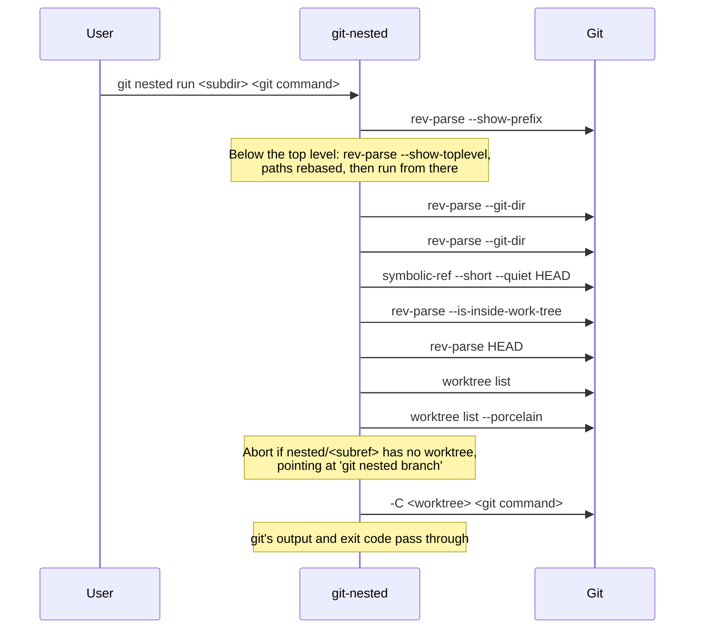

---

## repair

```mermaid
sequenceDiagram
    participant User
    participant git-nested
    participant Git

    User->>git-nested: git nested repair <subdir>
    git-nested->>Git: rev-parse --show-prefix
    Note over git-nested: Below the top level: rev-parse --show-toplevel,<br/>paths rebased, then run from there
    git-nested->>Git: rev-parse --git-dir
    git-nested->>Git: rev-parse --git-dir
    git-nested->>Git: symbolic-ref --short --quiet HEAD
    git-nested->>Git: rev-parse --is-inside-work-tree
    git-nested->>Git: update-index -q --ignore-submodules --refresh
    git-nested->>Git: diff-files --quiet --ignore-submodules
    git-nested->>Git: rev-parse --verify HEAD
    git-nested->>Git: diff-index --quiet --ignore-submodules HEAD
    git-nested->>Git: diff-index --quiet --cached --ignore-submodules HEAD
    git-nested->>Git: rev-parse HEAD
    git-nested->>Git: worktree list
    git-nested->>Git: merge-base --is-ancestor <parent> HEAD
    Note over git-nested: Stop here if there is no parent,<br/>or it is still an ancestor of HEAD

    git-nested->>Git: log --format=%H -- <subdir>/.gitnested
    loop Each commit, newest first, until one changed the recorded upstream commit
        git-nested->>Git: show -s --format=%P <commit>
        git-nested->>Git: cat-file -p <first parent>:<subdir>/.gitnested
        git-nested->>Git: cat-file -p <commit>:<subdir>/.gitnested
    end
    Note over git-nested: Its first parent is the new sync point;<br/>abort if it is the root commit

    git-nested->>Git: add -f -- <subdir>/.gitnested
    git-nested->>Git: rev-parse --short <sync point>
    git-nested->>Git: commit --no-verify [--signoff] [-S] -m <message>
    Note over git-nested: If it fails: reset -q --hard HEAD
```

---

## commit

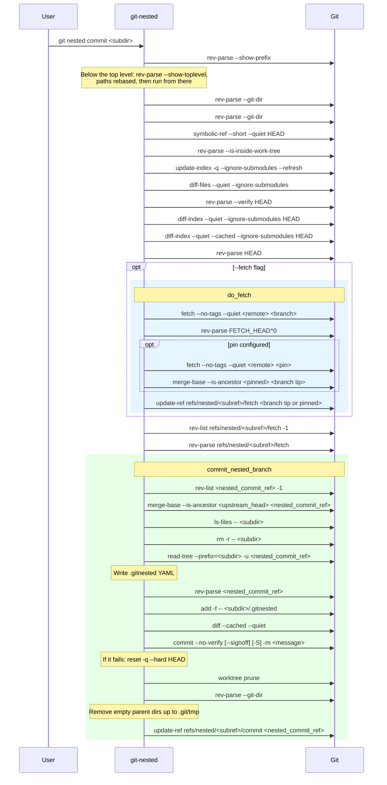

---

## status

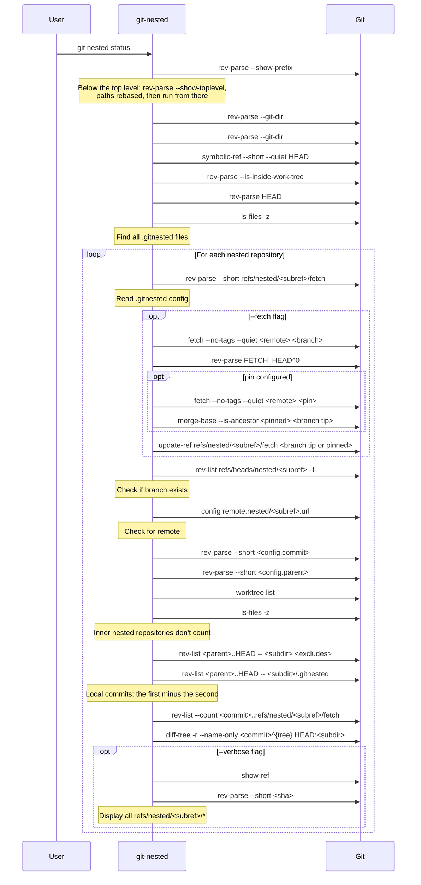

---

## diff

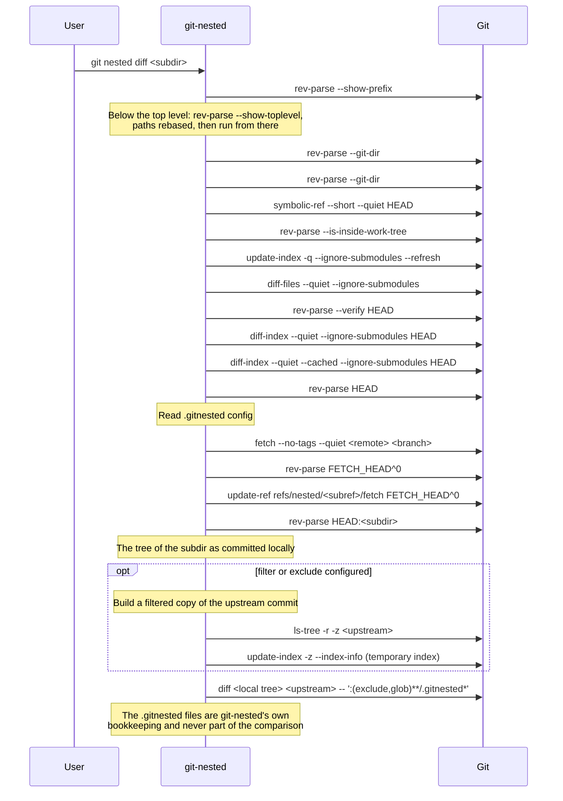

---

## clean

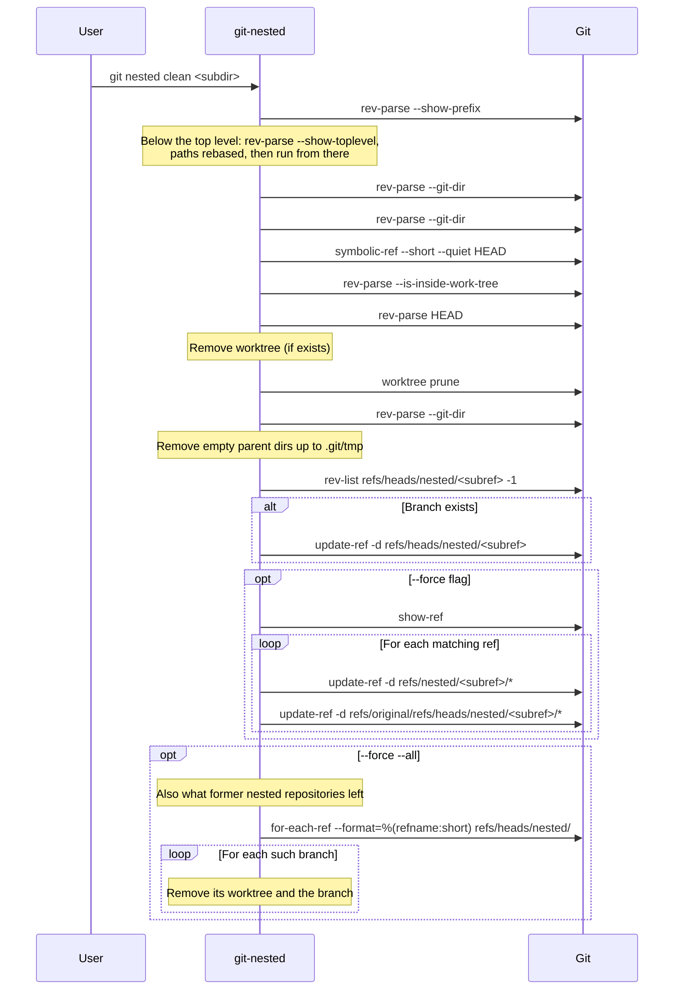

---

## config

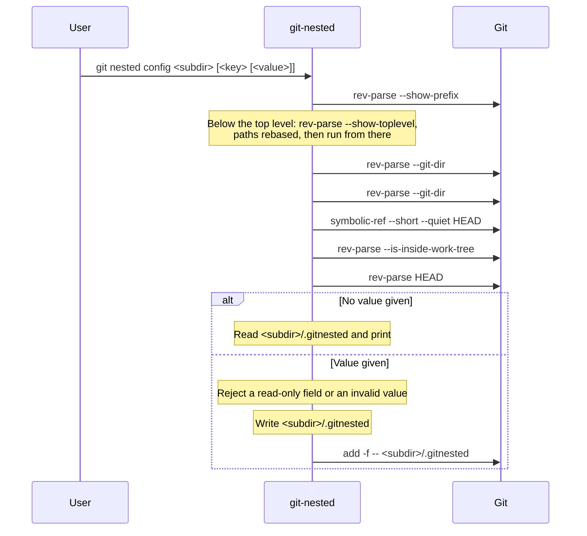

---

## version

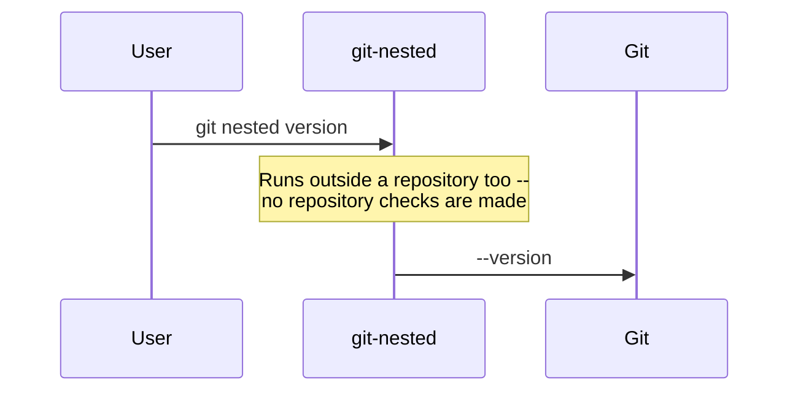
